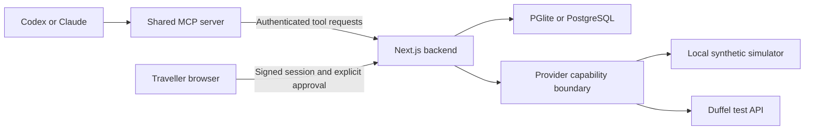

# Architecture

FlightPilot separates conversation tools from private checkout. The current deployment is one local user, one backend process and a test-only flight provider. Domain logic is shared by browser and MCP callers; no OpenAI or Anthropic model API key is needed by the server itself.

## Boundaries

`packages/shared` owns strict Zod contracts, money/offer/booking types and explicit provider capabilities. Booking and ticket verification are separate interfaces. The active providers support test booking; the build rejects live credentials and live provider response data.

`packages/providers` normalizes supplier responses and preserves original offer payloads. Duffel uses official HTTPS endpoints with request deadlines and no automatic purchase retry. Correlation metadata helps manual reconciliation; it is not a claim that the provider guarantees idempotency. TBO, Amadeus and Skyscanner are researched candidates, not implemented adapters.

`packages/pricing-engine` uses Decimal.js for currency and Luxon for elapsed journey times. It excludes unsuitable or incomparable offers and returns category-specific reasons. Unknown baggage costs remain unknown. Weights express preferences rather than invented financial charges or airline quality scores. Results compare only offers returned by the active provider.

`packages/core` resolves the curated airport list, owns saved search context, reprices offers, validates traveller ages, enforces ownership and manages checkout transitions. Raw offers are encrypted before persistence. Safe projections remove raw payloads from MCP and browser output. Traveller identity is sent through authenticated forms to the provider and is not intentionally persisted.

`apps/mcp-server` exposes the nine shared schemas over stdio or a local authenticated Streamable HTTP endpoint. It sends the workspace bearer token only to the configured backend, rejects redirects and returns structured results with actionable errors. Stdio reserves stdout for protocol messages. The optional HTTP process binds loopback, validates Host/Origin and limits request bodies. This is not a hosted multi-user OAuth service.

`apps/web` handles workspace sign-in, search/comparison, browser-local preferences, checkout and history. Approval requires a signed HTTP-only cookie, a matching Origin and an explicit consent payload. Bearer-authenticated MCP tools cannot directly invoke the browser-only approval route. The API token is also the signing secret for the local session cookie; rotating it invalidates sessions.

## Checkout and recovery

Search → selection → reprice → review → explicit approval → attempt claim → provider test order → status retrieval.

A checkout expires at the earlier of the offer expiry and 15 minutes after creation. Its version and approved amount are checked before submission. Material changes detected during repricing return the checkout to review with a new version. An atomic database update claims only a `review` row at the expected version. A unique owner/offer index prevents parallel checkout links for the same offer from creating separate attempts.

Once an attempt is processing, repeated approvals do not create another order. Status distinguishes reservation, confirmation and ticketing. A declined simulated payment is a definite failure; ambiguous upstream results remain uncertain and require reconciliation. A process failure after claiming can leave a processing checkout. There is no automatic recovery worker that retries the purchase.

This build has no real payment collection or 3DS implementation. Duffel test booking uses the test balance. A future real checkout must add approved payment collection and payment-aware pricing before enabling any live adapter.

## Persistence and observability

The Store uses Drizzle over PGlite by default, or the `pg` driver with `DATABASE_URL`. Tables use an indexed owner column, ID, timestamps and a domain-typed JSONB payload. Tables exist for users, preferences, searches, offers, observations, checkouts, attempts, bookings, ticketing, payments, webhooks and audits. Web preferences currently remain in browser local storage; the preference table is reserved.

Schema setup creates tables/indexes idempotently. It is not a versioned production migration/rollback system. PGlite is intended for one backend process per data directory. MCP processes call that backend and never independently open its database.

Raw offer payloads use AES-256-GCM with the configured encryption key. The app stores payment references/state rather than card data. Structured logs allow only diagnostic fields such as request IDs and error codes. Request IDs are returned for troubleshooting; upstream response bodies and traveller objects are not logged by the application logger.

Retention cleanup removes searches/offers/observations inactive for 24 hours and operational records inactive for 90 days. It runs during backend initialization and `pnpm db:migrate`, not continuously. Protect the database and encryption key together in development; production key rotation, scheduled retention and backup/recovery need implementation.

Duffel test webhooks validate signatures and timestamp freshness, store processing records and refresh known orders from the provider. The local server is not internet-reachable by default. Production webhook delivery, replay/recovery operations and supplier certification remain launch work.

See [limitations](limitations.md) and the [production checklist](production-checklist.md) for the boundaries that must change before real sales.
